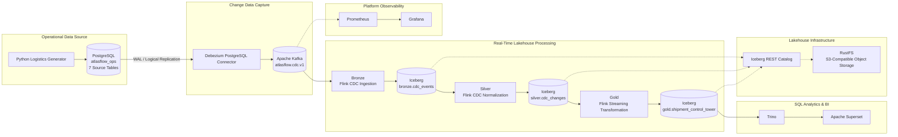

# 🚚 AtlasFlow — Real-Time Logistics Control Tower


---

## 📌 Project Overview

**AtlasFlow** is an end-to-end, real-time data engineering project built around a global logistics and supply chain use case.

The project simulates the operational data of a fictional logistics company, **ABC Logistics**, and builds a real-time Logistics Control Tower that brings shipment, order, customer, carrier, inventory, tracking, and disruption information together.

The business objective is to help logistics operations teams identify shipment delays, inventory shortages, active disruptions, and high-risk shipments as operational data changes.

We use PostgreSQL as the operational database, Debezium for Change Data Capture (CDC), Apache Kafka for event streaming, Apache Flink SQL for continuous processing, and Apache Iceberg for the lakehouse storage layer. Trino provides SQL access to the Iceberg tables, while Apache Superset turns the Gold data into an interactive business dashboard.

The entire environment runs locally using Docker Compose.

---

## 🎯 Business Problem

Logistics operations involve multiple systems:

- Order management
- Warehouse and inventory management
- Transportation and carrier management
- Shipment tracking
- Logistics disruption monitoring

When these systems operate independently, it becomes difficult for operations teams to get a unified view of shipment status and identify problems early.

For example:

- Which shipments are currently at high risk?
- Which carriers have the most delayed or high-risk shipments?
- Which warehouse regions have inventory shortages?
- Which shipments are affected by active disruptions?
- Why is a particular shipment classified as high risk?

AtlasFlow addresses this problem by continuously processing operational changes and combining them into a unified, shipment-level control tower dataset.

---

## 🏗️ Architecture

The project follows a **Bronze → Silver → Gold** data architecture.



### Pipeline Flow

1. **PostgreSQL:** Stores the operational data for customers, orders, inventory, carriers, shipments, tracking events, and disruptions.
2. **Python Generator:** Creates realistic baseline tracking events and operational fault scenarios. All generated changes are committed to PostgreSQL first.
3. **Debezium:** Captures database changes from PostgreSQL using logical replication and publishes CDC events to Kafka.
4. **Apache Kafka:** Acts as the central event-streaming layer. Business CDC changes are routed to one consolidated topic: `atlasflow.cdc.v1`.
5. **Bronze:** A Flink streaming job ingests the raw Debezium CDC envelopes and Kafka metadata into an Iceberg table.
6. **Silver:** A Flink streaming job parses and normalizes the CDC events into a common change-history structure.
7. **Gold:** A continuously running Flink SQL transformation reads the Silver CDC history, builds the current-state views, calculates shipment risk, and writes keyed updates to the Gold Iceberg table.
8. **Trino and Superset:** Trino queries the Iceberg data, and Superset provides the business dashboard.
9. **Observability:** Prometheus and Grafana monitor the platform and its infrastructure.

### Important Design Decision: Streaming Gold Without Extra Silver Tables

The current implementation intentionally keeps the Silver layer simple.

| Layer | Persistent Iceberg table | Purpose |
|---|---|---|
| Bronze | `atlasflow.bronze.cdc_events` | Raw CDC events |
| Silver | `atlasflow.silver.cdc_changes` | Normalized CDC history |
| Gold | `atlasflow.gold.shipment_control_tower` | Current shipment state and risk |

There are no separate eight-table Silver current-state models.

Instead, Gold reads the append-only Silver CDC history and creates temporary views inside its streaming query to identify the latest valid records for each source entity. It combines those records to build the shipment-level business model.

The Gold table uses `shipment_id` as its key and supports streaming upserts, allowing an existing shipment row to be updated as new operational changes arrive.

---

## 🗄️ PostgreSQL Source Tables

The operational database is named `atlasflow_ops` and contains seven related source tables.

| Source Table | Description |
|---|---|
| `customers` | Customer names, segments, and country information |
| `orders` | Order details, product SKU, quantity, and delivery promises |
| `inventory_balances` | Warehouse stock, reserved quantities, and damaged inventory |
| `carriers` | Carrier details, service levels, and home regions |
| `shipments` | Shipment status, associated orders, carriers, and warehouses |
| `tracking_events` | Shipment milestones, tracking locations, and delay information |
| `disruptions` | Active logistics disruptions, severity, and expected delay |

These tables are related through primary keys and foreign keys where applicable. The Python generator writes to the existing tables rather than bypassing PostgreSQL to publish directly to Kafka.

---

## ⚡ Technology Stack

| Technology | Role in AtlasFlow |
|---|---|
| PostgreSQL | Operational OLTP database |
| Python | Synthetic logistics data generation |
| Debezium | PostgreSQL Change Data Capture |
| Apache Kafka | Central event streaming |
| Apache Flink SQL | Continuous data ingestion and transformation |
| Apache Iceberg | Open table format and lakehouse tables |
| RustFS | S3-compatible object storage |
| Iceberg REST Catalog | Iceberg catalog and metadata management |
| Trino | SQL query engine for Iceberg tables |
| Apache Superset | Business intelligence and dashboarding |
| Docker Compose | Local containerized infrastructure |
| Prometheus | Metrics collection and monitoring |
| Grafana | Infrastructure observability |
| GitHub Actions | Automated static validation |

---

## 🔥 Key Features

### 1. Operational Data Generation

- Synthetic customers, orders, inventory, carriers, and shipments are initialized in PostgreSQL.
- Baseline tracking events simulate ordinary shipment activity.
- Fault-bundle generation creates a delayed shipment, tracking exception, and active port disruption.
- Shipment status is synchronized with generated tracking events.
- Inventory values are designed to demonstrate shortages across multiple warehouse regions.
- Optional continuous baseline generation can produce recurring operational updates.

### 2. Change Data Capture

- PostgreSQL logical replication using `pgoutput`.
- Debezium PostgreSQL connector.
- One consolidated business CDC topic: `atlasflow.cdc.v1`.
- Initial snapshot followed by ongoing database changes.

### 3. Bronze Layer

- Continuous Kafka ingestion using Flink SQL.
- Raw Debezium envelopes are stored in Iceberg.
- Kafka topic, partition, offset, and ingestion metadata are retained.

### 4. Silver Layer

- Continuous processing of Bronze Iceberg data.
- JSON extraction and normalization.
- Common entity identifiers and source table information.
- Operation types and data-quality labels.
- Append-only CDC change history in `atlasflow.silver.cdc_changes`.

### 5. Gold Layer

- Long-running Flink streaming transformation.
- Current-state reconstruction from Silver CDC history.
- Joins across customers, orders, inventory, carriers, shipments, tracking events, and disruptions.
- Keyed Iceberg upserts using `shipment_id`.
- Shipment risk classification and primary risk explanation.
- Continuously updated shipment-level business data.

### 6. Logistics Control Tower Dashboard

The Gold dataset powers the Superset dashboard, which can include:

- Total shipments
- High-risk shipments
- Inventory shortage shipments
- Active disruption links
- Shipment distribution by risk level
- High-risk shipments by carrier
- Inventory shortages by warehouse region
- Shipment attention queue with the primary risk reason

### 7. Observability

- Prometheus metrics collection.
- Grafana platform-observability dashboard.
- Kafka UI for topic and message inspection.
- Flink dashboard for streaming job status.
- Docker service health checks.

---

## 🚦 Gold Business Model and Risk Classification

The Gold table, `atlasflow.gold.shipment_control_tower`, contains one keyed record per shipment.

It brings together:

- Shipment and order identifiers
- Customer and carrier information
- Warehouse region and destination country
- Product SKU and order quantity
- Available-to-promise inventory
- Latest tracking event type, time, and location
- Tracking delay minutes
- Active disruption count and expected disruption delay
- Inventory shortage flag
- Risk level and primary risk reason
- Refresh timestamp and streaming identifier

### Risk Classification

The current Gold transformation applies the following priority:

| Risk Level | Conditions |
|---|---|
| **HIGH** | Shipment status is delayed or exceptional; tracking reports a critical exception; an active disruption exists; or available inventory is below order quantity |
| **LOW** | Shipment status is delivered, provided no higher-priority risk condition applies |
| **MEDIUM** | Latest tracking event reports a delay and no higher-priority condition applies |
| **WATCH** | No higher-priority risk signal is detected |

The `primary_risk_reason` column explains the first applicable risk condition. This allows operations teams to prioritize shipments and understand why they require attention.

---

## 🧪 Running the Project

### Requirements

- Windows 10 or Windows 11
- Docker Desktop with Docker Compose v2
- PowerShell 5.1 or PowerShell 7
- Python 3.10+
- Sufficient memory and disk space for the containerized stack

### Quick Start

Start Docker Desktop and open PowerShell in the repository root.

Prepare the local environment:

```powershell
.\scripts\prepare-local-env.ps1
```

This prepares the local `.env` file, creates the Python virtual environment, and installs the required Python dependencies.

Start the platform:

```powershell
docker compose up -d --build
```

The complete eight-step pipeline procedure is documented in [`MANUAL-RUNBOOK.md`](MANUAL-RUNBOOK.md).

**Important:** PostgreSQL initialization scripts execute automatically when the PostgreSQL data volume is first created. Existing Docker volumes preserve their data; `docker compose down -v` is destructive and should not be used casually.

---

## 🔄 Data Generation

The generator supports two one-shot scenarios and an optional continuous mode.

### Baseline Scenario

Creates ordinary shipment tracking events and synchronizes shipment status with the generated event.

```powershell
.\.venv\Scripts\python.exe .\generators\generate_logistics_data.py --scenario baseline --count 12 --seed 7
```

### Fault-Bundle Scenario

Updates `SHP-008` to delayed, inserts an exception tracking event, and creates an active port-congestion disruption.

```powershell
.\.venv\Scripts\python.exe .\generators\generate_logistics_data.py --scenario fault-bundle
```

### Optional Continuous Generation

Generates four baseline tracking events per batch, with a 30-second interval between batches.

```powershell
.\.venv\Scripts\python.exe .\generators\generate_logistics_data.py --scenario baseline --continuous --count 4 --interval-seconds 30 --seed 7
```

Press `Ctrl+C` to stop continuous generation.

Continuous mode is supported for the baseline scenario only. The fault bundle remains a one-shot scenario.

All generated changes are committed to PostgreSQL first. Debezium captures them, and they flow through Kafka, Bronze, Silver, and Gold.

---

## 📊 Dashboard

The main business dashboard is built in Apache Superset using the Trino connection to the Gold Iceberg table.

**Gold dataset:**

```text
atlasflow.gold.shipment_control_tower
```

The dashboard should emphasize shipment risk and operational action.

Suggested visualizations:

1. Total Shipments — Big Number
2. High-Risk Shipments — Big Number
3. Inventory Shortages — Big Number
4. Active Disruption Links — Big Number
5. Shipment Distribution by Risk Level — Donut Chart
6. High-Risk Shipments by Carrier — Horizontal Bar Chart
7. Inventory Shortages by Warehouse Region — Bar Chart
8. Shipments Requiring Attention — Table

The table should highlight HIGH and MEDIUM shipments and display `primary_risk_reason`, tracking delay, inventory shortage, and disruption information.

---

## 🔗 Service Endpoints

All services are intended for local development and are exposed through the configured Docker Compose ports.

| Service | Local URL |
|---|---|
| PostgreSQL | `localhost:55432` |
| Apache Kafka | `localhost:9092` |
| Kafka Connect API | http://localhost:8083/connectors |
| Kafka UI | http://localhost:8090 |
| RustFS Object Storage API | http://localhost:9000 |
| Iceberg REST Catalog | http://localhost:18181/v1/config |
| Flink Dashboard | http://localhost:8081 |
| Trino | http://localhost:18080 |
| Apache Superset | http://localhost:8088 |
| Prometheus | http://localhost:9090 |
| Grafana | http://localhost:3000 |

Superset and Grafana login credentials are generated or configured in the local `.env` file.

For Superset, the Trino SQLAlchemy connection uses the Docker service hostname:

```text
trino://atlasflow@trino:8080/atlasflow/gold
```

Do not replace `trino` with `localhost` in this container-to-container connection string.

---

## 📂 Repository Structure

```text
AtlasFlow_YouTube_Edition/
│
├── .github/
│   └── workflows/
│       └── atlasflow-static-validation.yml
│
├── connectors/
│   └── postgres-cdc-connector.json
│
├── docker/
│   └── postgres/
│       └── init/
│           ├── 00-atlasflow-bootstrap.sh
│           └── 10-atlasflow-schema.sql
│
├── generators/
│   └── generate_logistics_data.py
│
├── infra/
│   ├── flink/
│   │   └── Dockerfile
│   ├── observability/
│   │   ├── blackbox/
│   │   ├── grafana/
│   │   └── prometheus/
│   ├── superset/
│   │   ├── Dockerfile
│   │   ├── init_superset_admin.py
│   │   └── superset_config.py
│   └── trino/
│       └── catalog/
│           └── atlasflow.properties
│
├── runtime/
│   ├── bronze/
│   ├── silver/
│   └── gold/
│
├── scripts/
│   ├── check-atlasflow-static.py
│   ├── create-connect-topics.ps1
│   ├── prepare-local-env.ps1
│   ├── register-debezium-connectors.ps1
│   ├── setup-cdc-publications.ps1
│   ├── smoke-test-atlasflow.py
│   ├── start-gold-stream.ps1
│   ├── submit-streaming-stage.ps1
│   ├── verify-atlasflow.ps1
│   ├── wait-for-cdc-snapshot.py
│   └── wait-for-demo-events.py
│
├── sql/
│   ├── bronze/
│   │   ├── bootstrap_bronze_tables.sql.template
│   │   └── 01_cdc_to_bronze.sql.template
│   ├── silver/
│   │   ├── bootstrap_silver_tables.sql.template
│   │   └── 01_cdc_to_silver.sql.template
│   └── gold/
│       ├── bootstrap_gold_tables.sql.template
│       └── stream_shipment_control_tower.sql.template
│
├── .env.example
├── .gitignore
├── compose.yaml
├── MANUAL-RUNBOOK.md
├── README.md
└── requirements.txt
```

---

## ✅ Validation

The repository includes static validation and live health-check utilities.

Run the static checks in a clean source checkout without a local `.env` file:

```powershell
python .\scripts\check-atlasflow-static.py
```

For live platform diagnostics, the repository also includes:

```powershell
.\scripts\smoke-test-atlasflow.py
```

Static validation checks repository structure, SQL template presence, Python syntax, YAML/JSON configuration, and key pipeline contracts. It does not replace a live Docker integration test of Flink SQL jobs.

---

## 🔐 Security and Usage Notes

- This is a local educational and demonstration environment.
- Do not expose the services publicly without proper security configuration.
- Keep `.env` private and never commit credentials or passwords.
- Do not reuse local development credentials in other environments.
- Do not remove Docker volumes unless you intentionally want to delete the stored project data.
- Streaming job behavior should be verified in the local Docker environment.

---

## 👨‍💻 Author

Isaiah nyakundi 
